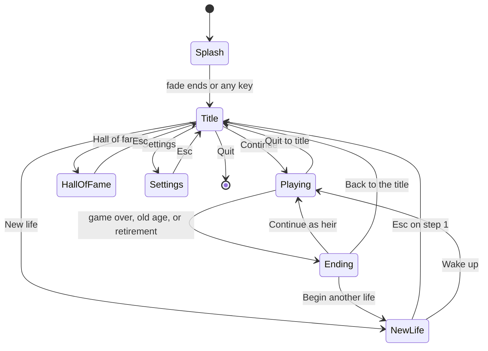
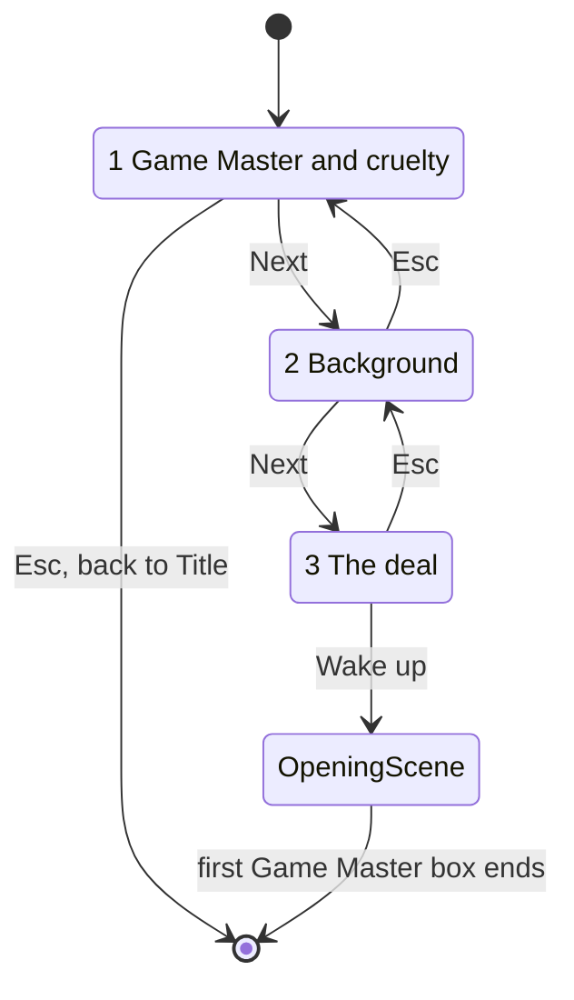
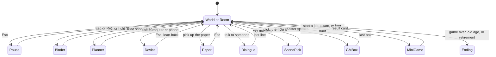
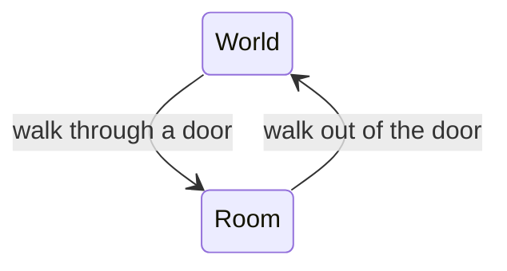
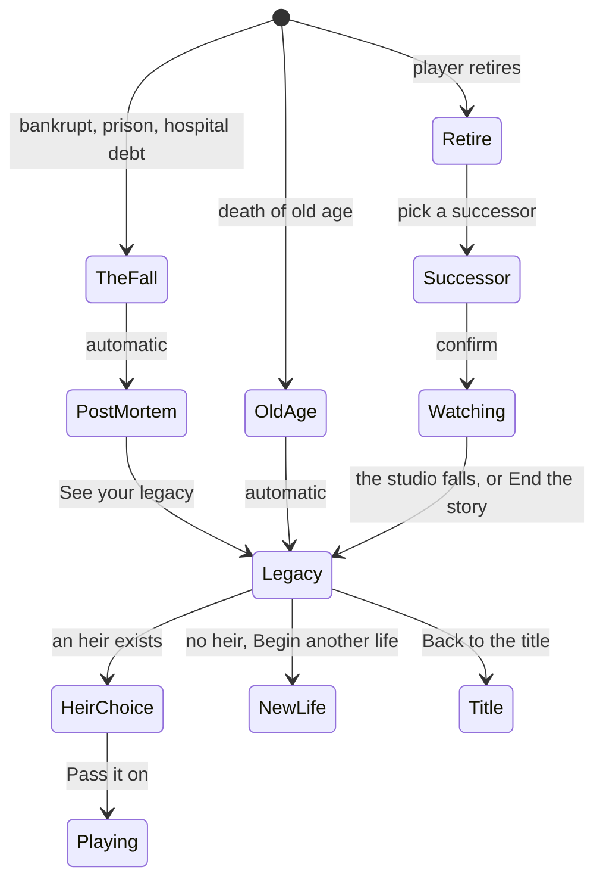

# DevLife Tycoon: UI/UX proposal (revision 2)

Date: 2026-10-12. Status: proposal, second round. It starts the talk. The designer (you) and the engineer will change it.

Mockups: open `mockups/index.html` in a browser. There are 14 pages. Each is a 1280 by 720 frame, which is the 640 by 360 game canvas at 2x.

**Naming.** The player-facing name for the narrator is **Game Master**. The design doc calls it the storyteller. This file uses Game Master everywhere the player sees it. The design doc and two mockup file names (`02-new-life-storyteller.html`, `06-storyteller-cryptic.html`) keep the old word so links hold.

**What changed in revision 2** (details in the sections named):
- 02: new wording, Game Master voice (S05).
- 03: the deal is now a cork board with one red thread (S07). 03b is an alternative, a candle-lit reading.
- 09: the paper is a folded, worn 1978 local paper (S21).
- 11: the legacy page is a black-paper album with a film strip of the eras (S26).
- 12 is new: the character sheet and journal as a ring binder (S17).
- A craft layer (6.10) and the inspiration notes (6.11).

Sources read: `design/GAME_DESIGN.md`, the Refactoring UI skill (rules cited by number below), and `src/hud.rs`, `src/splash.rs`, `src/main.rs`, `src/clock.rs`.

---

## 1. The proposal in ten lines

1. The UI has two layers. The **stable core** never changes: where things sit, what they mean, which keys work. The **era skin** changes with the eras: material, colour, corners, icons, motion.
2. The bedroom-era skin is beige plastic, square corners, 2-pixel ink outlines, hard shadows, and a fixed 16-colour palette like an old home computer.
3. The HUD is three small parts at the screen edges: me (portrait, stamina, money), time (clock, date, speed), and a one-line toast. The world keeps the centre.
4. Stamina is ten LED segments. Money is a coin and a number. Time is a clock with a sun or moon. Knowledge shows only when it changes, or when you hold Tab. Labels are a last resort.
5. One overlay sits on top of the World or Room view at a time. Esc closes it. With no overlay, Esc opens the pause menu.
6. There is no save button. The game saves itself, one file per life. A small era icon blinks when it writes.
7. The Game Master owns the dark undertow. It speaks in cold boxes that take the screen. A **chill** level from 0 to 3 cools the box and adds garbled glyphs.
8. New life is three steps: Game Master and cruelty, background, the deal. The deal is a cork board where the Game Master weaves one red thread through your hand. Wake up is the one irreversible click.
9. Devices (computer, phone) are lean-in overlays with their own era skin. In-game sheets are real objects of the era: a ring binder first. News is a morning paper.
10. A life ends in a chain: the fall, the post-mortem replay, the legacy page, then heir, new life, or title.

---

## 2. What the design doc asks of the UI

| Design doc says | UI answer |
|---|---|
| Cozy surface, dark undertow | Warm plastic, paper and cute animals everywhere. The cold only comes with the Game Master. |
| UI changes with the eras; stable core HUD plus era-styled devices | Stable core and era skin, split in section 6.9. |
| The Game Master is locked in; cryptic boxes | A lock note beside the choice. Chill ladder for the boxes. |
| Post-mortem shows the trail, never all details | Tape replay with choices, omens seen, omens missed. Hidden words stay hidden. |
| Era-accurate news is the information channel | Morning paper in the bedroom era. |
| 640 by 360 canvas, crisp pixels | All UI sizes are whole canvas pixels. Dither masks, no blur, no glow. |
| Dark-Souls-hard | No save-scumming, no take-backs, no odds on screen. Costs and gates are sure, so they show. |
| Click to walk; click objects in rooms | Hover tag names the object and its default verb. Right-click lists more verbs. |

---

## 3. Screen and state map

### 3.1 State diagrams

Boot and menus:



New life:



Playing. One base view and one overlay at a time:



World and Room (the camera zooms out to frame the room):



The end of a life:



### 3.2 Overlay rules

- The base view is World or Room. At most one overlay sits on it.
- The pause menu is the exception. It can sit on top of any overlay.
- **Must-answer overlays** are the Game Master box, the scene pick, and dialogue. Esc never closes them. Esc opens the pause menu, and the box waits.
- **Reading overlays** are the binder (Me sheet and Journal), Planner, Device, and Paper. Esc or a click outside closes them.
- The clock: must-answer overlays and the pause menu stop it. See open question 7 for reading overlays.

### 3.3 What Esc does

| State | Esc does |
|---|---|
| Splash | Nothing. Any key skips. |
| Title | Nothing. This stops accidental quits. |
| Hall of fame, Settings | Back one screen. |
| New life, step 1 / 2 / 3 | Back to Title / step 1 / step 2. |
| World or Room, nothing open | Cancels a selected target or verb list first. Then opens Pause. |
| Reading overlay | Closes it. |
| Dialogue, scene pick, Game Master box, mini-game | Opens Pause. The thing waits. Nothing is skipped or forfeited. |
| Pause | Resumes. |
| Settings opened from Pause | Back to Pause. |
| Post-mortem, legacy | Nothing. Space steps. A link skips to the end. |
| Heir choice | Back to the legacy page. |

### 3.4 Keys and mouse

| Input | Action |
|---|---|
| Left click | Walk there, or use the thing under the cursor. |
| Right click or hold | Verb list for the thing under the cursor (2 to 5 verbs). |
| Mouse wheel | Street zoom, three steps (exists today). |
| Q / E | Turn the street view (World only, exists today). |
| Space | Pause or resume time. Also advances a box. |
| T | Fast-forward on or off (exists today). |
| Esc | Close overlay, or open Pause. |
| Tab (hold) | Peek at the ME tab of the binder. Tap to pin it. |
| J / P | Binder at the last tab / Planner. Left and Right change tab in the binder. |
| 1 2 3 | Pick a card in a scene pick. Enter confirms. |
| Arrows, Enter | Move and press in every menu. |
| F1 | Controls list. |

---

## 4. Screen catalogue

Each block gives: purpose, primary action (one per view), what it shows, input, and what is era skin versus stable core. "Mockup" names the file in `mockups/`.

### S01 Splash (exists)
- **Purpose:** the credit.
- **Primary:** none. Any key or click skips.
- **Shows:** "Made with Claude / Fable and Opus" and the jumping pixel Clawd.
- **Input:** any key, any click.
- **Skin / core:** neither. It is a fixed credit screen. Keep as built.

### S02 Title and main menu
- **Purpose:** continue a life, start a life, or leave.
- **Primary:** Continue. On first run there is no life, so New life is primary.
- **Shows:** the logo, five items (Continue, New life, Hall of fame, Settings, Quit), a version line, and an optional one-line whisper from the Game Master (open question 4).
- **Input:** click, or arrows and Enter. Esc does nothing.
- **Skin / core:** the five items and their order are core. The set around them (deck, room) is skin. Later, the title can wear the skin of your current life.
- **Mockups:** `01a-title-window.html` (concept A, the bedroom is the menu) and `01b-title-tape-deck.html` (concept B, your life is a cassette).

### S03 Hall of fame
- **Purpose:** read back finished lives.
- **Primary:** Open the selected life. It opens its legacy page (mockup 11).
- **Shows:** one row per finished life: portrait, name, years, legacy title, how it ended. **Empty state:** "No tapes yet. Your first life will be here."
- **Input:** arrows, Enter, Esc.
- **Skin / core:** list is core. The tape art is skin.
- **Mockup:** the detail page is `11-legacy-obituary.html`. The list is not drawn yet.

### S04 Settings
- **Purpose:** display, sound, controls, access, game options.
- **Primary:** Done. Changes apply at once.
- **Shows:** five tabs. Display (window mode, UI size, pixel-perfect lock). Sound. Controls (every key listed and rebindable). Access (reduce flicker, large UI, high contrast, subtitles). Game (autosave icon on or off).
- **Input:** mouse, arrows, Esc.
- **Skin / core:** plain. It never changes with eras and the Game Master never touches it (open question 4).
- **Mockup:** not drawn.

### S05 New life 1: Game Master and cruelty
- **Purpose:** choose the locked-in narrator and the separate difficulty. The Game Master is the animal that weaves your story.
- **Primary:** Next: Background.
- **Shows:** a step bar, the heading "Choose a Game Master", the line "They are your narrators, they weave your story. Choose carefully.", three Game Master cards, a quote from the chosen one in the cold box style, a four-stop cruelty slider (Gentle, Fair, Harsh, Merciless), and the note "Locked for the whole life." beside the button.
- **Input:** click a card, drag the knob. Left and Right pick a card. Up and Down move the slider. Enter goes on. Esc goes back.
- **Skin / core:** all core. The title and setup screens stay dark so the cards stand out.
- **Mockup:** `02-new-life-storyteller.html`. Each card and the quote speak in the narrator's voice: it weaves your story. The first build has one awake Game Master (theme: Rivals and politics). The two sleeping cards show how the layout grows. Drop them from the first build.

### S06 New life 2: background
- **Purpose:** choose your direction (muscle head, nerd, art kid, and so on).
- **Primary:** Next: The deal.
- **Shows:** the same card layout as S05. Each card has an icon, a name, and two short lines: what comes natural, and what fights you. Example: "Muscle head. Stamina holds. C++ fights you."
- **Input:** as S05.
- **Skin / core:** core.
- **Mockup:** not drawn. It reuses S05.

### S07 New life 3: the deal
- **Purpose:** reveal the random animal, home, and pocket as one hand. Start the life.
- **Primary:** Wake up.
- **Shows (concept: the board):** the Game Master pins your life to your bedroom wall and weaves one red thread through it. In order: you (a school photo, name, species, a background sticker, strengths and a weakness as tick and cross lines), your home (a photo of the flat, the house rules on a note from your parents), your pocket (computer, money, college fund, bike), and last, an alarm clock. A seed tag stands on the shelf. The note "Your Game Master and background lock when you wake up." sits beside Wake up. There is no redeal.
- **Input:** click the name to edit it. Click Wake up (the clock rings). Esc goes back.
- **Reveal, in order (animate-ready):**
  1. 0.0 s. The board is bare. The crow lands on the frame (3 frames). A lamp pool flickers on.
  2. 0.5 s. The thread runs to pin 1, one canvas pixel a frame. The school photo slaps down (6 px high, 0, minus 2, 0). The board shakes 2 px for 2 frames. A tick sound rises in pitch with each pin.
  3. 0.9 s. The background sticker stamps on at 2x, then 1x. The trait lines write in one by one.
  4. 1.8 s and 3.0 s. Pins 2 and 3 land the same way. The thread runs down the right side to the clock.
  5. 3.8 s. The clock bells tremble (a 2-frame shake). Wake up un-greys. A click before this fast-forwards the whole reveal.
  Tilts are drawn into the sprites. Never rotate textures.
- **Skin / core:** the order and the facts are core. The cork, paper, photos, and tape are skin.
- **Mockups:** `03-new-life-the-deal.html` (the board, recommended) and `03b-new-life-the-deal-reading.html` (an alternative: a candle-lit reading with three tall cards). Open question 11 asks which to build.

### S08 Opening scene
- **Purpose:** hand over to the game. The Game Master introduces the era.
- **Primary:** click to go on.
- **Shows:** fade from black, an era card ("The bedroom era, 1978"), then one warm (chill 0) Game Master box. Then the street.
- **Input:** click or Space. Esc opens Pause.
- **Skin / core:** the card is skin. The box is the Game Master box (S14).
- **Mockup:** not drawn. It reuses mockup 06 at chill 0.

### S09 World state (the street)
- **Purpose:** roam the city.
- **Primary:** none. The world is the primary. Click to walk.
- **Shows:** the HUD from section 5.
- **Input:** left click walks or uses. Right click lists verbs. Q and E turn. Wheel zooms.
- **Skin / core:** HUD slots are core. Panel look is skin.
- **Mockup:** `04-hud-street.html`.

### S10 Room state
- **Purpose:** act on objects in one room.
- **Primary:** none. Click an object.
- **Shows:** the same HUD. The room name appears once as a toast when you enter. A hovered object gets a 2-pixel cream outline and a verb tag. There are no Q and E buttons. The door shows its gem.
- **Input:** as S09, without turning.
- **Skin / core:** same as S09.
- **Mockup:** the HUD is `04`. The room itself is not drawn.

### S11 Verb list
- **Purpose:** pick one of several verbs on an object.
- **Primary:** the first verb, which is also the left-click default.
- **Shows:** a small plastic list next to the object, 2 to 5 rows. Each row has the verb and sure costs as chips (time, bolts, money). A locked verb shows a lock chip with the gate, such as "Logic 2".
- **Input:** right click or hold to open. Click a row. Esc or a click away closes it.
- **Skin / core:** list is core. Plastic is skin.
- **Mockup:** not drawn. It uses the chips from mockup 08.

### S12 Dialogue box
- **Purpose:** a person speaks.
- **Primary:** continue (click or Space).
- **Shows:** a bottom-centre box: portrait, name, one line (45 to 75 characters per row). No answer menu. Answers are things you do in the world, as the design doc says.
- **Input:** click or Space. Esc opens Pause.
- **Skin / core:** frame is skin. Layout is core.
- **Mockup:** not drawn. It is the Game Master box (06) in warm colours, with a person's portrait.

### S13 Scene pick
- **Purpose:** choose what to *do* at a key moment.
- **Primary:** Do it. The cards are choices, not buttons.
- **Shows:** a scene title and two lines. Two to four action cards. Each card shows its sure costs (time, stamina bolts, money) and its gates (lock chip or tick). The HUD stamina bar previews the loss as hatched segments. It never shows odds.
- **Input:** click or press 1 to 3 to pick. The picked card lifts. Enter or Do it confirms. Esc opens Pause.
- **Skin / core:** card shape is skin. Costs and gates are core.
- **Mockup:** `08-scene-pick.html`.

### S14 Game Master box
- **Purpose:** the Game Master speaks. It may warn, hint, or turn sinister.
- **Primary:** continue (click or Space).
- **Shows:** bars close in at the top and bottom. The HUD hides. Time stops. A cold box holds the portrait, the name, and the text. Some words are gone or shifted. A copy goes to the binder, Journal tab, "Notes from the Game Master".
- **Input:** click or Space. Esc opens Pause.
- **Skin / core:** the chill ladder (section 6.8) is core. The warm frame at chill 0 is skin. Corner ornaments in sky mark the box.
- **Mockup:** `06-storyteller-cryptic.html`, with the chill ladder under the frame.

### S15 Day planner (school and college)
- **Purpose:** plan the blocks of a school day.
- **Primary:** Start the day.
- **Shows:** the day as 1 to 2 hour blocks. Fixed blocks (class) are locked. Open blocks take a focus. Each block shows its costs.
- **Input:** P or the school bell opens it. Click blocks. Esc closes.
- **Skin / core:** a paper diary in the bedroom era. The block logic is core.
- **Mockup:** not drawn.

### S16 Mini-game frame (jobs, exams, bug hunts)
- **Purpose:** one shared frame for all mini-games.
- **Primary:** whatever the game needs. After the game: Continue on the result card.
- **Shows:** the game area, a thin top bar with the activity name, the clock, and the stamina bar. The rest of the HUD hides. A result card lists what changed.
- **Input:** game-specific. Esc opens Pause and never forfeits.
- **Skin / core:** frame is skin. Bar and result card are core.
- **Mockup:** not drawn.

### S17 Character sheet and Journal (S18): one binder
- **Purpose:** check yourself and keep what you must remember.
- **Primary:** none. The sheet is read-only. A detail card may hold one secondary button, such as "Mark on my map".
- **Shows:** a 1978 school ring binder with five colour tabs: ME, SKILLS, KNOWLEDGE, PEOPLE, JOURNAL. Every tab is a two-page spread with the same row pattern (tile, title, one line, status mark). SKILLS: a list of "in training" on the left page. A grid of skill tiles, with level pips and a detail card, on the right page. A taped map inset shows where to use a skill. KNOWLEDGE: pips by field and the gates they open. PEOPLE: the ones you met. JOURNAL: Notes from the Game Master (every box, same glitches), Today (plan and toast log), Clippings. ME: portrait, exact stamina, reputation, permanent record, home rules.
- **Status marks use shapes, never colour alone:** clock = learning, gem = ready to use, down arrow = fading, tick = done.
- **Input:** J opens the binder on the last tab. Hold Tab to peek at ME. Left and Right change tab. Esc closes. The HUD chips stay on screen.
- **Skin / core:** the binder, ruled paper, tabs, and doodles are skin (later: terminal pages, glossy tabs, a flat app). The five tabs, the row pattern, the tile grid with a detail card, and the status shapes are core.
- **Mockup:** `12-character-sheet.html` (the SKILLS tab).

### S19 Home computer (device)
- **Purpose:** use the machine: pages, jobs, news, later your own code.
- **Primary:** one per page. On the jobs page it is "Call about it".
- **Shows:** you lean in to a beige monitor with stepped CRT corners and scan lines. Windows have striped title bars. The first machine can only read pages, in a teletext style: 100 Jobs, 200 News, 300 Shops. The HUD stays outside the monitor. An empty Mail window explains why it is empty.
- **Input:** click. Arrows move in lists. Esc leans back.
- **Skin / core:** the monitor, windows, and fonts are skin. The HUD, the lock and bolt chips, and the lean-in rule are core.
- **Mockup:** `07-home-computer.html`.

### S20 Phone and other devices
- **Purpose:** calls and messages. Bedroom era: the landline and its answering machine.
- **Primary:** one per screen (Play message, Call back).
- **Shows:** the same lean-in frame as S19. The skin follows the era: answering machine, pager, mobile phone, smartphone.
- **Input:** as S19.
- **Skin / core:** as S19.
- **Mockup:** not drawn.

### S21 News (morning paper)
- **Purpose:** the main information channel. News arrives here.
- **Primary:** Put the paper down.
- **Shows:** a folded, worn local paper: a pixel masthead with ears and a dateline, a lead story with a halftone photo, ads with their own voices, and classifieds. Omens hide in the small print. A cut-here guide shows on the hovered story. Click it, or press C, to clip it. Your own earlier clip shows as a blue pen loop. Space turns the page.
- **Input:** click, Space, Esc.
- **Skin / core:** newsprint is skin. Later: TV bulletin, web page, feed. One lead, small items, clip action are core.
- **Mockup:** `09-morning-paper.html`.

### S22 Pause menu
- **Purpose:** stop and step out.
- **Primary:** Resume.
- **Shows:** a modal with Resume, Journal, Settings, and a link, Quit to title. A line saying when the game last saved. One whisper line from the Game Master when the chill is 2 or more.
- **Input:** Esc or click Resume. Arrows and Enter.
- **Skin / core:** plain. Quit asks nothing. The life is already saved.
- **Mockup:** `05-pause-menu.html`.

### S23 Era card
- **Purpose:** mark a new era. The UI skin changes behind it.
- **Primary:** continue.
- **Shows:** a full-width card with the era name, the year, and one Game Master line.
- **Input:** click or Space.
- **Skin / core:** the card uses the new skin.
- **Mockup:** not drawn.

### S24 The fall
- **Purpose:** show that the life is over. This is a short beat, about 4 seconds.
- **Primary:** none. It moves on by itself.
- **Shows:** the world freezes and shifts to the dusk palette. One cold Game Master line names what happened. The HUD hides.
- **Skin / core:** cold box (chill 3).
- **Mockup:** not drawn. It reuses mockup 06.

### S25 Post-mortem replay
- **Purpose:** reveal the poison trail, but not all details.
- **Primary:** See your legacy.
- **Shows:** the life as a tape. Three mark shapes: choices (gem), omens you saw (filled feather), omens you missed (hollow feather). A year axis. One detail card for the selected mark. Hidden words stay as black blocks. The Game Master speaks last.
- **Input:** Left and Right step marks. Space plays. A link, Skip to the end.
- **Skin / core:** tape strip is skin. Mark shapes and rules are core.
- **Mockup:** `10-post-mortem.html`.

### S26 Legacy and obituary
- **Purpose:** judge the life. No win screen. The page is a memorial album.
- **Primary:** Continue as the heir. With no heir: Begin another life.
- **Shows:** a black-paper album spread. Left page: the epithet in big bitmap letters ("Cult legend"), the name, an aged portrait, and a torn obituary clipping. Right page: the games (four covers with year and score), the people (polaroids), and a sticky note from the heir. Across the bottom: a film strip of the life through the seven eras, ending on the Game Master's last line.
- **Input:** click. Esc does nothing.
- **Skin / core:** the album, tape, and photo corners are skin. The epithet, the games, the people, and the era strip are core.
- **Mockup:** `11-legacy-obituary.html`.
- **Reveal (animate-ready):** the portrait first, then the clipping, the four covers, the people, then the strip frame by frame. Each lands with a small tape slap. The last frame types in.

### S27 Heir choice
- **Purpose:** pick who inherits the studio.
- **Primary:** Pass it on.
- **Shows:** one card per heir (child, protege, partner): portrait, relation, three traits, what they inherit. Same card layout as S05.
- **Input:** as S05. Esc goes back to the legacy page.
- **Mockup:** not drawn.

### S28 Retirement watch
- **Purpose:** watch the successor from a distance.
- **Primary:** Keep watching, which runs time faster. A link, End the story, goes to the legacy page.
- **Shows:** news only (paper or feed) and a fast-forward control. The legacy score updates as the studio stands or falls.
- **Mockup:** not drawn.

---

## 5. HUD proposal (bedroom era)

### 5.1 Layout

All sizes are px at 720p. Halve them for canvas pixels. Margins are 16.

```
+--------------------------------------------------------------------------------+
| [portrait] [bolt LED x10]                              [sun  08:30   II > >>]  |
|            [coin $12.50 ]                              Mon 12 Sep 1978         |
| [book Logic +1]    <- 3 s after a change                                       |
|                                                                                |
|                          (the world fills the centre)                          |
|                                    [hand] Computer shop - Click to enter       |
|                                                                                |
| [bell Maths 09:00]        [ The corner shop is open. Mr. Pike waves you in. ]  |
| [      in 30 min ]                                       [save] [Q <] [> E] [?]|
+--------------------------------------------------------------------------------+
```

### 5.2 Parts

| Part | Shown | What it shows and how |
|---|---|---|
| **Me chip** (272 wide, top left) | Always | A 64-pixel animal portrait in a well (normal, tired, hurt faces). Stamina as ten LED segments. A coin and the money as a number. Click the portrait or press Tab for the binder (ME tab). |
| **Time chip** (248 wide, top right) | Always | A sun or moon (dusk variants), the clock in 24 hours at 30 px Bold, a date line (weekday, day, month, year) in muted 14 px, and three small buttons: pause, normal, fast. |
| **Toast** (max 560 wide, bottom centre) | Slot always there, empty most of the time | One line. 4 seconds. It is the only place sentences appear in the HUD. |
| **Corner controls** (bottom right) | Always, World only | Turn buttons Q and E, a help button, and the save icon, which shows only while it writes. |
| **Knowledge chip** | On change, 3 s | Book icon, the field, "+1", five pips. Under the Me chip. |
| **Next up chip** (bottom left) | 2 game hours before an appointment | Bell icon, title and time, "in 30 min". |
| **Verb tag** | While the hand cursor is over something usable | The thing's name and its default verb, on a dark tag at the cursor. |
| **Binder, ME tab** | Hold Tab | Exact numbers and knowledge by field. |

### 5.3 How each need shows, with no clutter

- **Stamina.** Ten LED segments in a dark well. Each segment is 10%. The count is the signal. Colour is a bonus.
  - 4 or more lit: green.
  - 3 or fewer lit: salmon, the bolt blinks once a second, and the portrait looks tired.
  - 1 lit: a "zzz" icon also appears.
  - A fork or a moon icon appears beside the bar only while hunger or sleep gives a penalty.
  - A cost preview shows as hatched segments (scene pick, verb list).
  - The exact number shows on hover (open question 9).
- **Money.** A coin and a number, 20 px Bold, with fixed-width digits. A change floats up beside it for 2 seconds: "+$3.00" or "-$1.20". A negative balance keeps the minus sign and turns rust-dark. The symbol "$" is a placeholder.
- **Knowledge.** It is slow and strategic. It needs a place to check, not a place to stare at. So it has three homes: the 3-second chip, the binder (KNOWLEDGE tab), and gate chips where it matters (a lock and "Logic 2", or a tick when you pass).
- **Time.** Always on. The date matters because school days and eras depend on it. When time is paused, the numerals turn muted, the pause button looks pressed, and the toast slot says "Time is paused. Space to go on." This is a label, and it is allowed because a missed pause is costly.
- **Odds and quests.** The HUD never shows them. News comes through the paper. Danger comes through omens in the world.

### 5.4 What changes from the current `hud.rs`

| Today | Proposal |
|---|---|
| Top left: "Day 1 · 08:00" and "You woke up a Fox." | The time chip moves to the top right. The fox line becomes the first Game Master box. The Me chip takes the top left. |
| Bottom right: a text strip with controls | Replaced by three small buttons and F1 help. |
| Toast | Kept as is. |
| One font weight (Semibold) | Semibold and Bold. |

---

## 6. Visual system

### 6.1 Pixel grid
- The canvas is 640 by 360. The mockups are 1280 by 720, which is 2x. One canvas pixel is 2 CSS px.
- Every size, border, and gap is a whole canvas pixel.
- Proposed UI scale: `floor(window_height / 360) / 2`. That gives 1.0 at 720p, 1.5 at 1080p, 2.0 at 1440p, 3.0 at 2160p. A 2 px border is then 2, 3, 4, or 6 physical pixels. No blur appears at any size.

### 6.2 Palette: 16 fixed colours
Every colour on every mockup is one of these. The bedroom era is limited on purpose.

| Name | Hex | Role |
|---|---|---|
| void | `#1C1714` | Darkest. Dark screens, letterbox. |
| ink | `#2B2420` | Text on light. Outlines. (Matches the code's `INK`.) |
| umber | `#52463D` | Wood, unlit LED, dark text on putty. |
| taupe | `#6B5F55` | Secondary text on plastic and cream. |
| clay | `#B8AE96` | Panel edge. Secondary text on dark. |
| putty | `#D4CAB0` | Panel shadow side. Text on dark. |
| plastic | `#E8E0CC` | Panel fill. (Matches `PANEL`.) |
| cream | `#F5F1EA` | Highlight, paper, text on dark. (Matches `BACKGROUND`.) |
| rust | `#A84E33` | Primary action. (Matches `ACCENT`.) |
| rust-d | `#8A3A22` | Primary shadow, danger text, legacy title. |
| salmon | `#E09A78` | Primary highlight, low stamina, glitch. |
| mustard | `#D9A93A` | Money, gems, lit windows, focus on dark. |
| moss | `#6B9148` | Stamina LED. Only inside a dark well. |
| denim | `#35618A` | Knowledge, devices. |
| sky | `#9FC7D8` | World sky. The Game Master's text colour. |
| night | `#232B4A` | The cold box. The dusk sky. |

Greys are warm (hue about 20 to 40 degrees). There is no pure black and no pure white. (Rule 33.)

One change from the code: `MUTED` (`#7A6E64`) is only 3.8:1 on the panel colour. Taupe (`#6B5F55`) replaces it at 4.7:1.

### 6.3 Contrast
Checked on 2026-10-12 (and again after revision 2) by a script over the rendered pages. No text in the 14 mockups is below 4.5:1. Text on baked art (the paper, the binder pages) is checked against the colour of the paper under it: plastic or cream.

| Text on background | Ratio |
|---|---|
| ink on plastic | 11.6 |
| ink on cream | 13.6 |
| taupe on plastic | 4.7 |
| taupe on cream | 5.5 |
| umber on putty | 5.6 |
| cream on rust | 4.9 |
| cream on rust-d | 6.9 |
| rust-d on cream | 6.9 |
| mustard on ink | 7.0 |
| sky on night | 7.7 |
| cream on night | 12.3 |
| salmon on night | 6.0 |
| clay on ink | 6.9 |
| cream on denim | 5.8 |
| ink on mustard | 7.0 |
| ink on salmon | 6.6 |
| ink on sky | 8.5 |
| ink on putty | 9.4 |
| denim on plastic | 4.9 |
| cream on umber | 8.1 |

**Do not use:** taupe on putty (3.8), plastic on rust (4.2; use cream), moss as text (3.5), rust or denim as text on ink (2.7).

### 6.4 Type
- One family: Source Sans 3. Two weights: Semibold (600) and Bold (700). These are the two files in `assets/fonts`.
- Scale in px at 720p: 14, 16, 20, 24, 30, 36, 48. Nothing is smaller than 14.
- Line height: 14/20, 16/24, 20/28, 24/32, 30/36, 36/40, 48/48.
- Text colours per surface: three at most. On plastic and cream: ink, taupe. On dark: cream, putty, clay.
- All-caps text gets +8% tracking. Numbers use fixed-width digits.
- Weakness: the gap between Semibold and Bold is small. So the hierarchy leans on size and colour as well as weight.

### 6.5 Spacing and depth
- Spacing scale (px at 720p): 4, 8, 12, 16, 24, 32, 48, 64, 96. The only other value is 2, as a hairline gap in LED bars and pips.
- 12 inside a group. 24 between groups.
- Depth uses three hard shadows, with no blur: 2 px (button), 4 px (panel), 6 px (modal). Light comes from above.
- **Raised:** light top edge (cream), dark base edge (putty), shadow below.
- **Inset (wells, inputs, LED bars):** dark or darker top edge, light bottom edge.
- **Veil:** a dither mask, not a blur. 25% density dims the world for menus. 50% is held back for the fall.

### 6.6 Buttons and focus
- **Primary:** rust fill, cream text, 48 px high in menus. One per view.
- **Secondary:** plastic fill, ink text.
- **Tertiary:** underlined text, no box.
- **Danger:** rust-d fill. It appears only in the confirmation step of an irreversible action, never on the page behind it.
- **Key cap:** a small cream chip with the key letter.
- **Focus:** a 2 px ink outline with a 4 px gap on light surfaces. Mustard on dark surfaces.
- Hit targets are at least 32 px high.

### 6.7 Icons and portraits
- Icons are drawn at 7 to 13 canvas pixels. They are 2-tone with an ink outline, so they read on any surface. They show at 2x only. Flat glyphs (play, pause, arrow) have no outline.
- Core icons and what they always mean: bolt = stamina, coin = money, sun or moon = time of day, book = knowledge, lock = a gate, bell = an appointment, cassette = save, gem = a place you can enter or a choice, feather = the Game Master and omens. In the binder: clock = learning, gem = ready to use, down arrow = fading, tick = done. Scissors = clip.
- Portraits are sprites at their own pixel size (3x or 4x). They sit in a well. They are never scaled inside the sprite.

### 6.8 The chill ladder (Game Master)
`chill` is a number from 0 to 3. The Game Master sets it. It affects boxes first.

| Chill | Box | Text |
|---|---|---|
| 0 Warm | Plastic panel, ink text | Clean |
| 1 Cool | Umber panel, cream text | Clean, slightly shorter |
| 2 Cold | Night panel, sky outline | A few glitch letters, one or two hidden words |
| 3 Frozen | Void panel, sky text | Torn lines, many hidden words |

- Hidden words are dither blocks. A raised or dropped letter is noise.
- Some hidden words can be solved with knowledge. Some are only mood. The look does not tell which.
- The glitch pattern is fixed per message. A replay and the Journal show the same text.
- At chill 2 or more the world can shift one step darker on the palette (the dusk palette in the mockups).
- "Reduce flicker" in Settings stops the animation. It does not stop the hiding of words.

### 6.9 Stable core versus era skin

| Stable core (never re-skinned) | Era skin (changes with the era) |
|---|---|
| Slots: Me chip top left, time chip top right, toast bottom centre, controls bottom right | Panel material and colour |
| Information: stamina, money, time, date | Corner shape and outline |
| Icon meanings (6.7) | Icon art style |
| Key map and Esc rules | Font choice (open question 10) |
| Overlay rules, one primary per view | Palette size |
| Hit target sizes | Motion: 2-frame steps now, eased fades later |
| Costs and gates on every action | Save icon: cassette, floppy, disc, cloud |
| Journal tabs, Me sheet fields | Devices: CRT computer and landline now, phones later |
| | News: paper, TV, web, feed |

Only the bedroom skin is specified. The rest is a direction. I assume this mapping (say so if it is wrong): era 1 beige plastic; eras 2 and 3 CRT green; era 4 glossy 2000s; eras 5 to 7 flat modern.

---

### 6.10 Craft layer (revision 2)
The UI is warm and made by hand. These are the craft rules. They apply on top of the system above.

- **Objects, not panels.** In-game sheets are real things of the era: a ring binder, a folded paper, a black-paper album, a cork board. Later eras swap the object. The slots, row patterns, and status shapes stay.
- **Art is baked. Text is live.** Boards, paper, and album pages are baked 640 by 360 textures with nearest sampling. All text, chips, buttons, and numbers are UI nodes over them. Only pixel logos (the masthead, the epithet, ad logos) are baked type.
- **Mounting.** Things are taped, pinned, clipped, or stuck: tape strips, pins, photo corners, sticky notes, a thread. Each has a 2 px ink outline, so it reads on any surface.
- **Ornaments.** Section heads wear a small flourish: a rule with a diamond, a marker squiggle, a corner bracket, or a star doodle. There is one ornament per head and no more. (In the binder: marker squiggles. On the pause box: corner brackets. On the Game Master box: sky corners.)
- **Tabs.** Each tab has its own muted colour. The colour always comes with a label and an icon. The open tab stands taller and its divider strip shows.
- **Row pattern.** Icon tile, title, one line of description, status mark. Used in lists on every sheet. The selected row gets a highlighter band (mustard, ink text). Skills show as a grid of square tiles with level pips and a detail card under or beside it.
- **Marks of use.** The world shows that someone lived here: a pen loop, a coffee ring, a folded crease, a doodle you did not draw. These are drawn into the art and never carry information alone.
- **Tilt.** No texture is ever rotated. Any tilt is redrawn as pixels.

### 6.11 Inspiration (ideas only, nothing copied)
- **Dealt hands in card roguelikes:** a spring flip, a small random tilt, layered feedback (a shake, a sound, a counter) so that one event feels solid. Used in the deal reveal.
- **Candle-lit table games:** a dealer hidden in the dark, a table with props, cards with personality, very little text on a card because low resolution hurts legibility. Used in the reading (03b) and the Game Master's shadow.
- **Evidence boards in detective games:** a cork board with pinned photos and string. One lesson: free-form string links get messy, so ours is one fixed thread, a cinematic touch, not a puzzle. Pixel fonts must stay at whole-number scale.
- **Document-desk games:** the work happens on paper objects on a desk. Used for the paper and the binder.
- **Tarot spreads:** a name on each card and a reading below it.
- **A cozy RPG menu the designer shared:** a tabbed parchment sheet, ornamented section heads, list rows with an icon tile, a title, one line and a status mark, square icon tiles with captions and a detail card, an inset map preview, and a hand-made, warm feel. We took the principles and drew our own: a 1978 binder, our palette, our icons.

Sources read while researching: [Balatro feedback design](https://blakecrosley.com/guides/design/balatro), [A look at 100%-interface games](https://indieklem.substack.com/p/20-a-look-at-100-interface-games), [Inscryption interview in Game Developer](https://www.gamedeveloper.com/design/how-game-jam-sacrifices-became-inscryption), [Shadows of Doubt devblog on case folders and cork boards](https://www.moddb.com/news/shadows-of-doubt-devblog-4-case-folders-cork-boards).

---

## 7. Refactoring UI rules used

Numbers follow the core rules list in the skill.

| Rule | Where |
|---|---|
| 1 Start with one feature | The mockups start with the title, the HUD, and one setup step. There is no nav shell. |
| 2 Grayscale first | I checked the mockups in grayscale. Each has one clearly dominant element and the primary is the darkest filled shape on light surfaces. On dark screens the primary reads a little weaker. Size and position carry it. |
| 3 Smallest useful version | One awake Game Master. Later features are marked "not drawn". |
| 4 Personality on purpose | Beige plastic, square corners, 2 px outlines, plain short wording. |
| 5 Limit choices | 16 colours, 7 sizes, 2 weights, 9 spacings, 3 shadows. |
| 6, 7 Hierarchy by weight and colour | HUD: dark wells and bold numerals lead. Date and hints go quiet. |
| 8 No grey on colour | Dark panels use cream, putty, and sky. There is no low-opacity text. |
| 9 Emphasise by de-emphasising | Asleep Game Master cards, dither veil under menus, hidden HUD in Game Master boxes. |
| 10 Labels last | No labels in the HUD. Values read as `08:30`, `$12.50`, `3 h`, `Home by 22:00`. |
| 13 Button pyramid | Rust, plastic, link. Danger is red only in a confirm step. |
| 14 Start with too much space | Setup, title, and the deal use wide margins. |
| 15 Spacing scale | 4 to 96. Audited. |
| 16 Do not fill the screen | Setup content is 1032 wide. The deck is 880. |
| 19 Avoid ambiguous spacing | 12 inside a group, 24 between. |
| 20, 21 Type scale and font | 14 to 48. Neutral sans with a tall x-height. |
| 22 Line length | Boxes have about 60 characters a line. Card text is narrower, 28 to 40. |
| 26 Align | Left-aligned text. Scores and years sit in a right column. Only mastheads centre. |
| 27 Tracking on caps | +8%. |
| 33 Tinted greys | All greys are warm. |
| 34 Contrast | Audited. Section 6.3. |
| 35 Not colour alone | Stamina count, hatch preview, three mark shapes, chosen card lift, tick and cross shapes. |
| 36, 37, 39 Depth | Raised and inset recipes. Three hard shadows. No blur. |
| 40 Overlap | The chosen card lifts over the row. The paper overlaps the dim world. |
| 43 Intended size | Icons only at 2x. Portraits at their own size. |
| 46 Accent border | A rust bar on the chosen card. A coloured divider strip under each binder tab. |
| 48 Empty states | Mail window, Hall of fame, first-run title. |
| 49 Fewer borders | Lists use an inverted bar and space, not rules. |
| 45 Supercharge defaults | Check marks, bullets, and underlines become icons, ticks, and marker squiggles. |
| 47 Decorate backgrounds | Cork, newsprint, black album paper, ruled binder paper. Low-contrast texture under text. |
| 50 Think outside the box | Title as a room or a deck. Scene picks as cards. The deal as a board. Skills as a tile grid. |

**Two honest deviations.** Rule 7 says no weights under 400, and we ship only 600 and 700. Rule 21 prefers a family with five or more weights, and we load two. A font with more weights would help the hierarchy.

---

## 8. Saving, in the Dark Souls tone

**Proposed model** (open question 2 asks you to choose):

1. The game saves by itself. There is one file per life. There is no manual save and no reload.
2. It saves on every game hour, on sleep, when you enter or leave a room, before and after every scene pick, and on quit.
3. Quitting never asks. It saves first. Continue loads the one file.
4. After a bad choice you cannot go back. That is the point of the tone.
5. A finished life moves to the Hall of fame and becomes read-only.
6. What carries across lives lives in a separate profile file. Deleting a life never deletes it.
7. For crashes only: the file is written to a temp name and then swapped in. The game keeps the previous autosave as a hidden backup. The player never sees or uses it as a rewind.

**How it shows:**
- No "Saved!" fanfare. A small era icon blinks bottom right for one second (a cassette in the bedroom era).
- The pause menu says "Saved 20 seconds ago" under its title. It has no Save and no Load.
- The title has no Load button. Continue is the only way back.

---

## 9. Notes for the engineer

- **Mockups are references, not code.** They use CSS box-shadows for bevels. In Bevy, build panels as nine-slice images from one small atlas (`assets/ui/bedroom/`) with nearest sampling.
- **Scale.** Use the UI scale in 6.1. Author everything at 720p numbers.
- **Text stays smooth.** Source Sans 3 is a vector font, so it stays smooth beside pixel panels. Open question 10 asks if you want a pixel face.
- **State.** Grow `Screen` to `Splash, Title, NewLife(step), Game, Ending(step)`. Inside `Game`, keep an `OverlayStack` resource. The Esc system reads its top entry and follows the table in 3.3.
- **Skin.** A `Skin` resource holds the tokens: colours, nine-slice handles, icon atlas, font, motion style. UI parts read it. An era change swaps the resource.
- **Chill.** A `Chill(u8)` resource drives the box skin and the palette shift. Garbling is a pure function: `garble(message_id, seed, chill)`. Replays and Journal use the same call.
- **Dither masks.** A 2 by 2 tiled image with nearest sampling, laid over the world.
- **Clock rules.** Must-answer overlays and Pause set a "stopped" flag on `GameClock`. Reading overlays follow open question 7.
- **Baked art, live text.** Boards, paper, album pages, and the binder are baked textures at canvas size, sampled with nearest filtering. Put real text, chips, and buttons on top as UI nodes. Never bake text into the art, except pixel logos.
- **Hand-made props.** Tape, pins, photo corners, and thread are small sprites. The red thread in the deal is drawn once as a baked line between three pin positions. Animate it by revealing it one pixel per frame.
- **Sheets are objects.** The binder, paper, and album share one `SheetObject` skin slot: a background texture, tab sprites, row and tile styles, and ornament sprites. An era swap changes the slot.
- **Suggested build order.** 1 Overlay stack, Pause, and Esc rules. 2 HUD v2 in place of `hud.rs`. 3 Settings (display scale first). 4 Title concept B. 5 New-life flow. 6 Dialogue and Game Master box. 7 Scene pick. 8 Devices and paper. 9 The ending chain. 10 Title concept A, if chosen.

---

## 10. Not designed yet (on purpose)

Background cards in detail, Settings tabs, the other binder tabs (ME, KNOWLEDGE, PEOPLE, JOURNAL), Day planner, mini-game frames, phone and later devices, later-era skins, hospital screen, world map and travel, contracts, staff and finance screens. Each needs a real feature first. (Rule 3.)

## 11. Assumptions (say so if one is wrong)

- Era skins map as in 6.9.
- The skin swaps behind a full-screen era card with one Game Master line. There is no slow morph.
- "$" is a placeholder currency symbol.
- Space pauses time. T keeps fast-forward.
- The clock is 24 hours.
- In the first build, Hall of fame is a plain list.
- Names in the mockups (Old Rook, Marmalade, Tick, Fenn Marrow, Halloran Software) are placeholders. The Game Master portraits are placeholder pixel art.
- The deal and the paper are written for the first Game Master (Old Rook, Rivals and politics). Other Game Masters may deal differently (open question 11).

---

## 12. Open questions

These need your decision. Each has a recommendation. Answer by letter.

**1. Which title screen concept?**
- A. The window at night. The bedroom is the menu. Strong mood. About 3 to 4 times the work.
- B. The tape deck. A flat deck where your life is a cassette. Cheap, fits the beige era, and shares the save idea.
- C. B now. A later, with the deck as a prop on the desk.
- *Recommend C.*

**2. How does saving work?**
- A. Pure autosave. One file per life. No manual save. No reload.
- B. Autosave, plus one "mercy rewind" per life that restores last night's sleep. The Gentle difficulty only.
- C. Manual save slots, with an optional Ironman box at new-life setup.
- *Recommend A. Keep B as a later gift for Gentle.*

**3. How many lives can be live at once?**
- A. One. A new life starts after the old one ends, or after you abandon it. An abandoned life goes to the Hall of fame as "walked away".
- B. Three slots.
- C. Unlimited.
- *Recommend A. The Game Master greets you across lives. One live life keeps that greeting clear.*

**4. How far does the Game Master reach into the menus?**
- A. Never. Menus are safe.
- B. Whispers only. One quiet line on the title, pause, and post-mortem screens. It never touches buttons or Settings.
- C. Everywhere. It can glitch menu text, rename buttons, and talk in Settings.
- *Recommend B. Option C would make the player doubt Settings.*

**5. Can the player redeal the random character and home?**
- A. No redeal. The seed shows, so friends can compare hands.
- B. One redeal per life. The second hand is final.
- C. Free redeals until you accept.
- *Recommend A. It matches "dealt like your home" and the tone.*

**6. What is the starting computer? The design doc says a "weak laptop that can only browse the web". The first era is 1978 home computers.**
- A. A 1978 home computer that can only read teletext-style pages (mockup 07). Fix the doc line.
- B. A literal laptop with a browser. It breaks the era look and the paper-first news.
- C. Make the start year a setup choice, with a start machine for each year.
- *Recommend A.*

**7. Does reading stop the clock?**
- A. The binder (Me sheet and Journal) stops it. Devices and the paper run it, and their actions cost minutes.
- B. Nothing stops it except Esc and Space. This is Dark Souls style.
- C. Everything stops it. Only actions cost time.
- *Recommend A.*

**8. What does a scene pick tell the player?**
- A. Sure costs and gates only. No odds. Danger shows as omens in the world.
- B. Costs, gates, and one risk word per card (Safe, Risky, Reckless).
- C. Costs, gates, and exact odds.
- *Recommend A.*

**9. How many numbers does the HUD show?**
- A. None. Bars and icons only, except money.
- B. Money always. Other numbers on hover and in the binder.
- C. Every number always, like a spreadsheet.
- *Recommend B.*

**10. Which type face for the UI?**
- A. Source Sans 3 everywhere. It is smooth and very readable. It is already loaded.
- B. A hand-drawn pixel face per era. It is authentic, costs more, and may be harder to read at 14 px.
- C. A pixel face for logos, headings, and the clock only. Source Sans 3 for body text.
- *Recommend C, later. Ship A first.*

**11. Which presentation for the deal (new life step 3)?**
- A. The board (03). A cork board and one red thread. The most memorable. The most art.
- B. The reading (03b). Three tall cards under candlelight. Calmer, faster to build.
- C. Each Game Master deals in its own way. Old Rook uses the board. Marmalade and Tick get their own tables later.
- *Recommend C. Build the board first. It matches the thread that Old Rook says it holds.*

**12. Is the binder one object?**
- A. One binder with five tabs (ME, SKILLS, KNOWLEDGE, PEOPLE, JOURNAL). J opens it. Tab peeks at ME.
- B. Two objects: a small Me card on Tab, and a Journal on J.
- C. One binder, plus a small Me card that follows the Me chip.
- *Recommend A. One object is simpler to learn, and the era swap changes only one thing.*

---

## 13. Files

```
design/ui/UI_PROPOSAL.md                       this file
design/ui/mockups/index.html                   index with live thumbnails and one-line captions
design/ui/mockups/01a-title-window.html        title, concept A: the window at night
design/ui/mockups/01b-title-tape-deck.html     title, concept B: the tape deck
design/ui/mockups/02-new-life-storyteller.html new life step 1
design/ui/mockups/03-new-life-the-deal.html    new life step 3, the board
design/ui/mockups/03b-new-life-the-deal-reading.html  new life step 3, alternative: the reading
design/ui/mockups/04-hud-street.html           HUD over the street
design/ui/mockups/05-pause-menu.html           pause menu
design/ui/mockups/06-storyteller-cryptic.html  Game Master box, with the chill ladder
design/ui/mockups/07-home-computer.html        bedroom-era computer
design/ui/mockups/08-scene-pick.html           scene pick
design/ui/mockups/09-morning-paper.html        news, bedroom era, a worn 1978 paper
design/ui/mockups/10-post-mortem.html          post-mortem replay
design/ui/mockups/11-legacy-obituary.html      legacy and obituary, the album
design/ui/mockups/12-character-sheet.html      character sheet and journal, the binder
```

The mockups need no network and no script. Fonts load from `../../../assets/fonts`. If your browser blocks them when you open a file from disk, run `python3 -m http.server` in `bevy-game` and open `/design/ui/mockups/index.html`.
